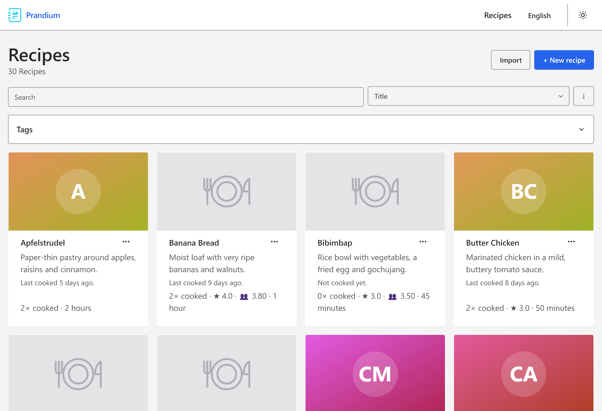
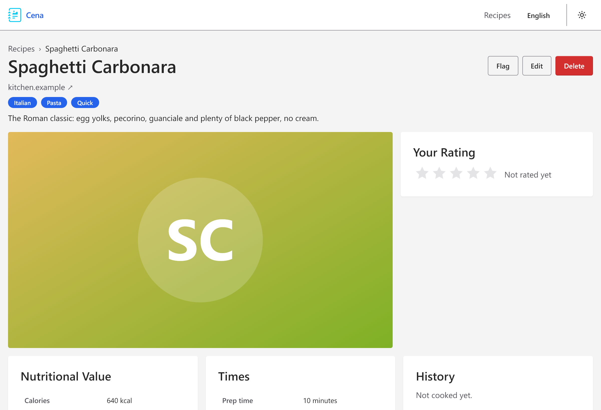
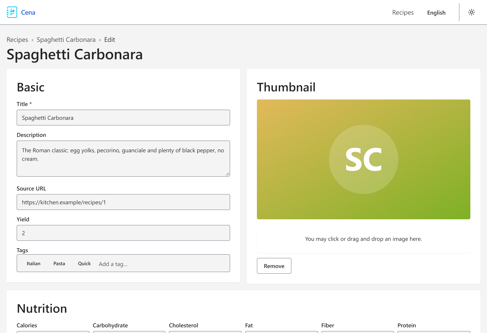
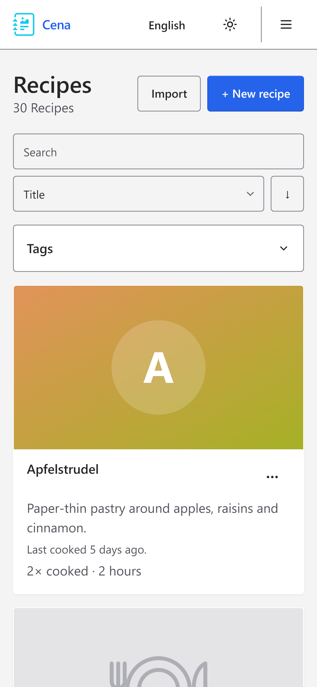
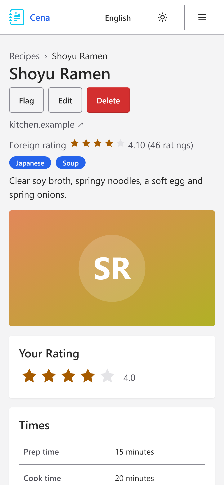

[](https://github.com/dhardtke/cena/actions/workflows/ci.yml)

#  Cena

Cena, Latin for [dinner](https://en.wiktionary.org/wiki/cena), is a small, self-hosted recipe manager for one household. A
[Bun](https://bun.sh) and SQLite backend serves a frontend of TypeScript custom elements styled with [Oat](https://oat.ink).

- Import recipes by URL from any site that publishes [schema.org](https://schema.org/) JSON-LD, with their image, tags, nutrition and
  reviews
- Search by title, sort by any of two dozen keys, and narrow the list by tags, with counts that follow the selection
- Keep track of when and how often you cooked a recipe, and rate it in half stars
- Scale the ingredients to the portions you cook, and keep the screen on while the recipe is open
- Create and edit recipes, tags and thumbnails in the browser
- English and German, a light and a dark theme, installable on your phone
- Optional password login, and a single-file build for deployment

<picture>
  <source media="(prefers-color-scheme: dark)" srcset="docs/screenshots/list-dark.png">
  
</picture>

## A look around

A recipe shows everything it holds: its source and foreign rating, its tags, nutrition, times, your history with it, and the ingredients,
scaled as you change the portions.

<picture>
  <source media="(prefers-color-scheme: dark)" srcset="docs/screenshots/detail-dark.png">
  
</picture>

Every field is editable, tags and the thumbnail included.

<picture>
  <source media="(prefers-color-scheme: dark)" srcset="docs/screenshots/edit-dark.png">
  
</picture>

Built for the phone on the kitchen counter.

<table>
  <tr>
    <td width="50%">
      <picture>
        <source media="(prefers-color-scheme: dark)" srcset="docs/screenshots/mobile-list-dark.png">
        
      </picture>
    </td>
    <td width="50%">
      <picture>
        <source media="(prefers-color-scheme: dark)" srcset="docs/screenshots/mobile-detail-dark.png">
        
      </picture>
    </td>
  </tr>
</table>

## Quick start

Requires [Bun](https://bun.sh) 1.4 or newer.

```sh
bun install          # Oat, plus TypeScript types for development
bun start            # http://127.0.0.1:8000
```

The database and the thumbnails live in `data/` under the working directory (override with `CENA_DB` and `CENA_THUMBNAIL_DIR`),
created and migrated on first run. The database of the old Prandium opens as it is; point `CENA_DB` at it, since the default is
now `data/cena.db`. To try Cena with sample recipes, `bun run seed && bun start`; seeding replaces whatever `data/` held.

| Variable                  | Default                 | Meaning                           |
| ------------------------- | ----------------------- | --------------------------------- |
| `PORT`                    | `8000`                  | Port to listen on                 |
| `HOST`                    | `127.0.0.1`             | Address to listen on              |
| `CENA_DB`                 | `data/cena.db`          | The SQLite database file          |
| `CENA_THUMBNAIL_DIR`      | `data/thumbnails`       | Holds the thumbnail images        |
| `CENA_PASSWORD_HASH`      | unset (no login)        | Hash from `bun run hash-password` |
| `CENA_DEV`                | unset                   | `1` turns on hot reload           |
| `CENA_IMPORT_CONCURRENCY` | the number of CPU cores | Recipes imported at once          |
| `CENA_USER_AGENT`         | a Firefox 86 user agent | Sent when importing               |

## Security

Without `CENA_PASSWORD_HASH` the server is open to anyone who can reach it — fine on your own machine or inside a private network,
never on the internet. Create the hash with `bun run hash-password` to enable the login, and put HTTPS in front of the server before
exposing it.

## Documentation

- [`docs/deployment.md`](docs/deployment.md) — building a single file, running it on a server, and the automatic deploys from `main`.
- [`AGENTS.md`](AGENTS.md) — every script, including test, typecheck, lint and format, and an index of the rest of `docs/`.

## License

[MIT](https://choosealicense.com/licenses/mit/)

## Acknowledgements

- [Bun](https://bun.com/)
- [Oat](https://oat.ink)
- [Peggy](https://github.com/peggyjs/peggy)
- [Oxlint](https://oxc.rs/docs/guide/usage/linter)
- [Nextcloud Cookbook](https://github.com/nextcloud/cookbook)
